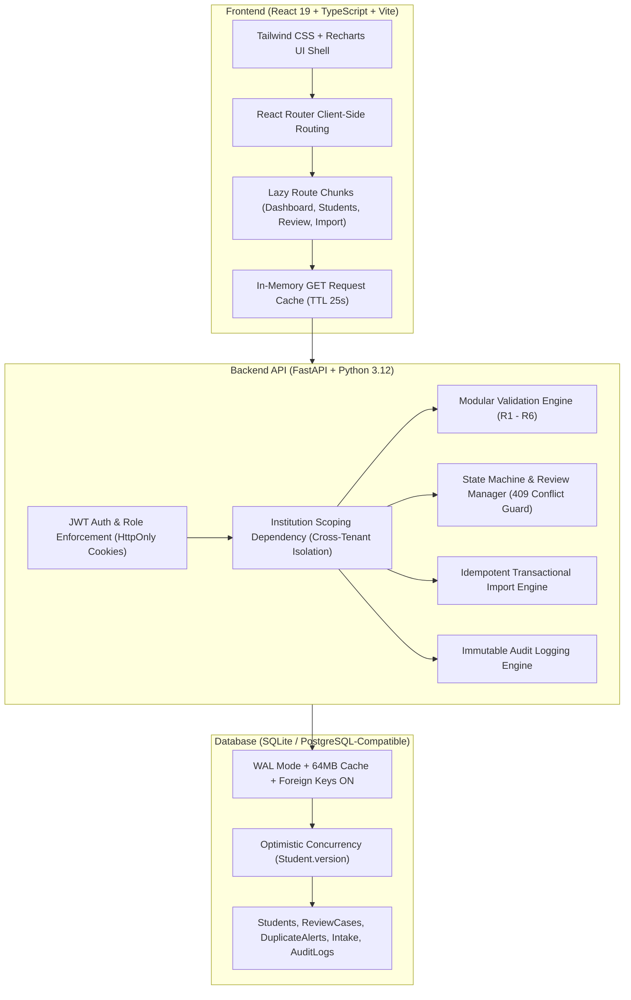
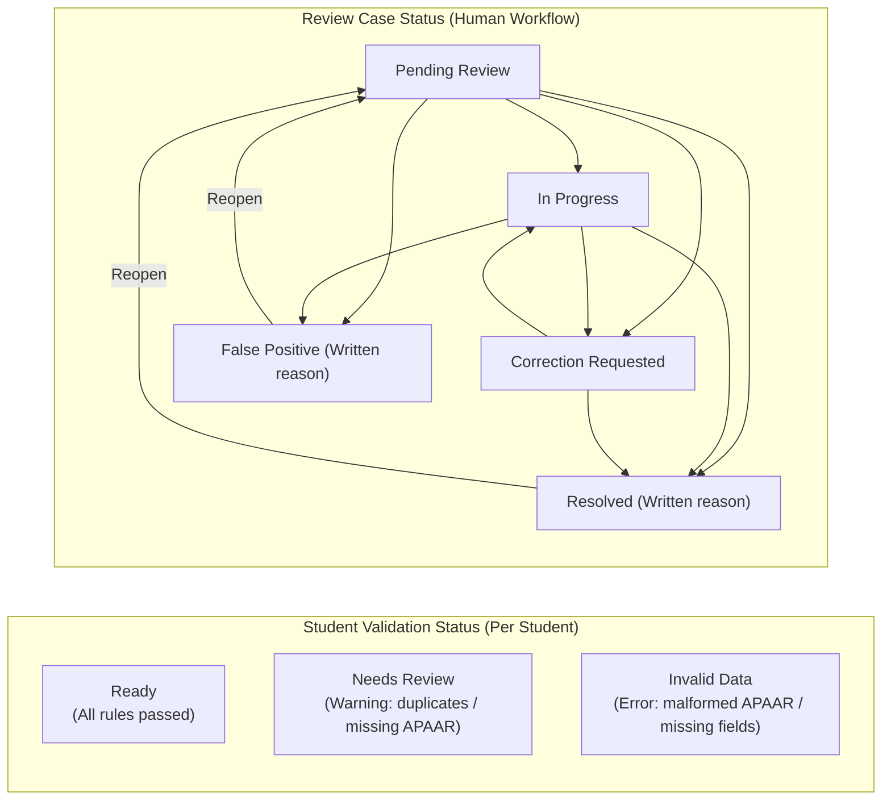

# APAAR GUARD — Architecture & System Design Specification

> **SIH Problem Statement SIH26263**  
> **Tagline:** Accurate Student Records. Transparent Verification. Trusted Data.  
> **Version:** 2.0 (Agile Production Increments)

---

## 1. Executive Summary & Verification Boundary

APAAR GUARD is a software-only governance and record-integrity web platform designed for AICTE-approved higher education institutions. The system maintains student academic identity records, provides robust CSV/XLSX bulk ingestion, runs local format and data-quality validations, detects potential duplicate identifiers, routes ambiguous cases to an audited human review queue, and monitors approved course intake capacities.

### Critical Verification Boundary Policy
```
               ┌──────────────────────────────────────────────┐
               │         APAAR GUARD BOUNDARY POLICY          │
               ├──────────────────────────────────────────────┤
               │  Local 12-digit format check and data-quality │
               │  rules do NOT prove identity or ID ownership.│
               │  No official government API is configured.   │
               │  System displays transparent boundary:       │
               │  "Official verification unavailable. Local   │
               │   checks are not official verification."     │
               └──────────────────────────────────────────────┘
```
- The platform **never** displays a fake "Officially Verified" badge.
- When an authorized API is plugged in, it connects through the extensible `OfficialVerificationService` interface (currently backed by `StubOfficialVerificationService` returning `"unavailable"`).
- Alerts employ neutral terminology (**Ready**, **Invalid Data**, **Needs Review**, **Correction Requested**, **Resolved**, **False Positive**) and **never** accuse students of fraud.

---

## 2. Core Architecture & Tech Stack



### Full-Stack Specifications
- **Frontend:** React 19, TypeScript, Vite 8, Tailwind CSS, Recharts, React Router v7, Lucide Icons, React Hook Form + Zod.
- **Backend:** FastAPI, Python 3.12, SQLAlchemy 2.0 (declarative ORM), Pydantic v2.
- **Database:** SQLite in production prototype mode with:
  - `PRAGMA journal_mode = WAL` (concurrent reads and writes without blocking)
  - `PRAGMA synchronous = NORMAL` (fast durable writes)
  - `PRAGMA foreign_keys = ON` (referential integrity enforcement)
  - `PRAGMA cache_size = -64000` (64MB dedicated in-memory page cache)
- **Security:** HTTP-only same-site cookies, JWT with HS256, bcrypt password hashing, input sanitization, complete cross-institution tenant isolation.

---

## 3. Dual Status Models & Issue Fingerprinting

A critical architectural pitfall in student records systems is conflating algorithmic validation status with human administrative determinations. APAAR GUARD decouples them completely:



### 3.1 Student Validation Status (Algorithmic)
- **Values:** `Ready`, `Invalid Data`, `Needs Review`.
- **Precedence:** `Invalid Data` > `Needs Review` > `Ready`.
- **Invalid Data:** Any rule failure with severity `"error"` (missing required fields, malformed APAAR length/characters, invalid academic year/course).
- **Needs Review:** No errors, but at least one failed rule with severity `"warning"` (exact duplicate APAAR match, duplicate roll number, possible duplicate name/DOB candidate, absent APAAR ID).
- **Ready:** Passed all validation rules.

### 3.2 Review Case Status (Human Determination)
- **Values:** `Pending Review`, `In Progress`, `Correction Requested`, `Resolved`, `False Positive`.
- **State Machine Enforcement:** Any transition outside the defined matrix returns `HTTP 409 Conflict`.
- **Reason Requirement:** Transitioning to `False Positive` or `Resolved` strictly requires a non-empty written justification (`HTTP 400 Bad Request` if blank).

### 3.3 Fingerprint Synchronization
Each issue generates a deterministic SHA-256 fingerprint:
$$\text{fingerprint} = \text{SHA-256}(\text{rule\_id} \,\|\, \text{student\_id} \,\|\, \text{normalized\_fields})$$

- **Validation runs never erase human decisions:** If a student is re-validated, an existing case marked `False Positive` remains suppressed if the fingerprint is unchanged.
- **Auto-Resolution:** If a record marked `Correction Requested` has its fields corrected and re-validated cleanly, the system automatically resolves the case with actor `"system"` and note `"Re-validation passed"`.
- **Reopening:** If an issue previously marked `Resolved` recurs with the exact same fingerprint, the system reopens it to `Pending Review` with `reopened_from_id` linked.

---

## 4. Aggregate Intake Monitoring & Capacity Boundary

Course intake capacity is scoped to:
$$\text{Scope} = (\text{institution\_id}, \text{course\_id}, \text{academic\_year})$$

- Intake overruns produce **one aggregate alert** per course scope.
- **Intake capacity never marks an individual student `Invalid Data`** or generates per-student review cases (admitting a 61st student into a 60-seat batch does not invalidate the student's personal identity or format).
- Intake configurations track source (`"manual_override"`, `"AICTE approval letter"`, etc.) and who modified them.

---

## 5. Optimistic Concurrency Control

To prevent race conditions and lost updates when multiple administrators work concurrently:
- Table `students` includes an integer column `version` (default 1).
- Every update request (`PUT /api/students/{id}`) requires the client to supply `version`.
- If `req.version != student.version`, the backend immediately rejects the request with `HTTP 409 Conflict`:
  > *"This record was changed by someone else. Reload and try again."*
- On successful update, `student.version` is atomically incremented by 1.

---

## 6. Identifier Masking & Secure Reveal

- **Masked in all general views:** APAAR IDs are rendered as `XXXX-XXXX-1234`.
- **Raw APAAR Storage:** Preserved as a 12-character string to prevent dropping leading zeros (e.g. `012345678901`).
- **Explicit Admin Reveal:**
  - Endpoint: `POST /api/students/{id}/reveal-apaar`.
  - Accessible **only** by users with `institution_admin` role (`HTTP 403 Forbidden` for Verification Officers).
  - Automatically records an immutable audit log entry: `action = "APAAR_REVEALED"`.
  - Full APAAR is **never** written to database audit logs or terminal logs.

---

## 7. Performance & Optimization Architecture

The application is built to deliver snappy, Vercel-grade responsiveness:
1. **Fast Initial Load:**
   - Production bundle code-splitting via Rollup `manualChunks`:
     - `vendor-react` (React, React Router, ReactDOM)
     - `vendor-charts` (Recharts isolated to demand)
     - `vendor-icons` (Lucide React)
   - Every secondary dashboard page is lazy-loaded with `React.lazy()` and `<Suspense>`.
2. **Instant Navigation:**
   - Client-side routing with shared persistent layout (Sidebar + Header + Demo Banner).
   - In-memory GET request cache with 25s TTL, automatically invalidated on mutations (`POST`, `PUT`, `DELETE`).
3. **Low-Latency Database Queries:**
   - Compound indexes: `(institution_id, admission_year, course_id)`, `(institution_id, roll_number)`.
   - Aggregations computed directly inside SQLite via `func.count()` and `group_by()` instead of fetching all ORM model objects into Python memory.

